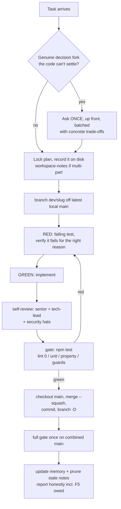
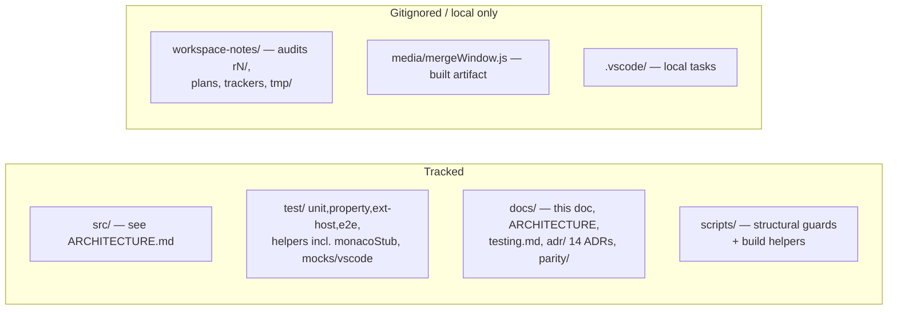

# IntelliG — Agent Handbook

The tribal knowledge for anyone (human or agent) continuing work on this
repo: how work flows, the rules that are locked, and every trap we have
already fallen into so you don't fall into it again. Read
`docs/ARCHITECTURE.md` first for what the code IS; this doc is how to
WORK on it.

## Section 1. The golden rules

1. **Never `git push`. Never open PRs from an agent.** The user reviews
   local `main` and owns every push. Never `reset --hard origin/main`.
2. **Local mainline is linear.** One short-lived `dev/<slug>` branch per
   task off the latest local `main`; land it with `git merge --squash` +
   one commit; delete the branch (`git branch -D` — squash merges never
   read as merged). No merge commits, no rebase-replays of history: when
   asked to land an end state in N clean commits, carve the diff by path
   from the target tree.
3. **TDD is the default.** New code red→green→refactor; bug fixes START
   with a reproducing failing test; behavior changes with a failing spec.
   PROVE the red: run it and watch it fail for the right reason before
   implementing.
4. **The gate** (before any merge, no exceptions): `npm test` — eslint 0
   warnings (lint is a required lane), tsc clean, structural guards, full
   unit + property suites. Report counts and drift from the baseline you
   started from.
5. **Every review/audit finding gets fixed, regardless of severity
   label.** Clean means zero findings. Don't triage LOWs into a backlog.
6. **Commit with explicit paths** — never `git add -A` or `git add .`
   (symlinked worktrees and gitignored coordination files leak in).
   Messages say what/why in plain language; never reference finding IDs,
   task IDs, or SHAs in code comments or commit messages.
7. **Read IntelliJ source, don't guess.** IntelliJ is a REFERENCE, not a
   spec (unpinned 2026-07-03) — but when you DO lean on its behavior,
   read the actual source in a local clone of
   https://github.com/JetBrains/intellij-community (usually `plugins/git4idea` or `platform/diff-impl` /
   `platform/util/diff`) and cite the path. Guessing has shipped
   silent-wrong behavior.
8. **Dogfood before "done".** Tests passing ≠ working software. UI work
   is not done until the user F5s it; say explicitly when F5 is still
   owed. Watch idle behavior too — feedback loops don't show in tests.
9. **Tests-passing traps**: a green suite can coexist with a broken
   product when a mock hides the runtime (see section 5). Runtime lanes
   (ext-host, e2e, webview-harness) must gate UI changes.
10. **Design prevents bug classes — decide where invariants LIVE before
    writing bodies.** When a plan calls for N similar handlers/views/ops,
    design ONE skeleton (spine/wrapper/base/type) that carries the shared
    invariants (guards, argument contracts, error surfacing, sanitize,
    refresh) and N thin bodies — never N hand-rolled skeletons. The command
    spine (src/commands/registration/commandSpine.ts) is the model: eight
    audit rounds kept re-finding classes that one up-front abstraction made
    unwritable. The Nth copy of a skeleton is a design finding even while
    every copy is still correct. Prefer unwritable (compile error / gate
    failure) over documented.
11. **A class fix is not done until the class is FENCED.** Fixing the
    found instances of a bug pattern is an instance fix; audits have
    re-found "closed" classes twice (unpinned stash pops, unanchored
    path strips) because nothing stopped new code from rejoining the
    pattern. Definition of done for any class-level fix: (a) the site
    fixes, (b) a reproducing test that failed first, AND (c) a guard in
    `check:all` (grep fence or eslint no-restricted-syntax rule, with
    the ADR-007 maintenance-contract header and a justification-comment
    escape hatch). When a later audit verifies a class as fixed, it
    runs the fence — it does not re-read the sites.
12. **A defence is not done until a NAMED test dies without it.** Rule
    11 fences the CLASS (a bug pattern, closed everywhere at once); rule
    12 fences the DEFENCE (one specific guard clause, proven to matter).
    Ten review rounds kept re-finding the same two shapes — a defence
    that stays green when deleted, and an assertion that stopped
    executing — because the gate could see neither; a reviewer noticing
    is a coin flip, not a mechanism. Definition of done for any
    defensive guard clause (a bail, a fallback, a re-check, an ordering
    dependency): add an entry to `scripts/mutation-manifest.json`
    (anchor, mutation, the file, the exact TITLE of the one test that
    must die, why) and confirm `npm run check:mutations` proves it — a
    defence with no manifest entry is indistinguishable from dead code,
    and this repo has proved that four times in four rounds. The `test`
    field names a file, not an assertion; `check-mutations.mjs` requires
    the mutation to fail specifically the test whose title matches
    `title`, not merely something in that file — a file shared by
    several entries can die on a sibling's assertion while the one an
    entry claims to prove stays green, and the exit code alone can't
    tell those apart. `check:mutations` runs in `gate:full`, not
    `npm test` (it mutates real source in a throwaway worktree per run —
    see the script's own header).

## Section 2. Product rules that are LOCKED (user decisions)

Do not relitigate these; do not "helpfully" reintroduce them:

- **Merge window**: NOTHING auto-applied on open unless the opt-in
  `intellig.mergeWindow.autoApplyNonConflicting` setting is on (IntelliJ
  default off). Toolbar matches IntelliJ's `MergeThreesideViewer`: Apply
  Non-Conflicting + Resolve Simple Conflicts bulk actions, Accept
  Yours/Theirs with a discard confirm over a modified result, Apply always
  enabled with a counted confirm while changes are unresolved.
- **Destructive-op confirms**: IntelliJ-style MINIMAL confirms — one
  modal for reset/drop/force-push class operations, never double-confirms.
  Force push defaults to `--force-with-lease`.
- **Colors/UI parity**: IntelliJ TYPE semantics (green inserted, blue
  modified, red conflict, grey deleted) in VS Code's THEME tones. UI
  layout and context-menu structure match IntelliJ, not just feature
  coverage.
- **Changelog style**: one plain human line per entry; no internal items.
  Release commit = bump package/lock + CHANGELOG; never push or tag.
- **Webviews**: DOM built via `createElement` — no HTML-string skeletons.
- **Comments**: describe the CURRENT code only. No history lessons, no
  "fixed bug N", no what-it-used-to-do. When a comment goes stale, delete
  it. Reviewers flag bad new comments as findings.
- **3-way merge**: the IntelliG merge window is the DEFAULT
  (`intellig.mergeWindow.enabled`, default on, user-flipped 2026-07-03);
  VS Code's native merge editor is the fallback (setting off or deps
  unavailable).
- **`package.json` `contributes` is additive-only** — no reordering; it's
  the most widely shared file in the repo.
- **Deliberately NOT doing** (don't re-propose): merged-branch cleanup
  (git4idea marks it internal), unshallow, Open-Exclude-File,
  Add-Commit-To-Remote-Branch, pixel-matching IntelliJ's Swing UI.
  Accepted visual non-matches: single-decoration blame gutter, webview
  flex-row log panel, QuickPick dialog paradigm.

## Section 3. Task lifecycle

Checkpoint at clean commit boundaries; never leave large half-done work
uncommitted (context can be lost at any time). For multi-part efforts,
write the plan and locked decisions to a gitignored
`workspace-notes/*.md` BEFORE building.

## Section 4. Repo geography

- Product vision + accepted non-matches live in `docs/ARCHITECTURE.md`
  section 1 (the tracked `docs/parity/` dir was retired when the project
  unpinned from IntelliJ, 2026-07-03); the working backlog is gitignored
  under `workspace-notes/`.
- `docs/adr/` — 14 decision records. Check them before re-deciding
  anything structural (interface freeze, watcher families, webview state,
  logger, atomic writes, sanitizer ordering, graph invariants...).
- `workspace-notes/audit/rN/` — per-round audit notes + reports (R4, R5,
  R6 exist; findings-are-leads discipline documented there).
- **Temp/scratch dirs in tests**: create under `workspace-notes/tmp/`,
  never `os.tmpdir()` or the repo root.
- Deliverables for the user (reports, images) go in the workspace, never
  in `/private/tmp` scratchpads.

## Section 5. Traps we already hit (pay attention here)

Build & packaging:

- **`.vscodeignore` is a minefield.** The extension is BUNDLED
  (`dist/extension.js` carries every runtime dep; `media/monaco/vs` is
  copied from monaco-editor at compile time), so `node_modules/**` and
  `out/**` are excluded wholesale — no re-includes, ever (a `!out/**/*.js`
  re-include once shipped the whole test tree + agent notes; a missing
  runtime file killed activation in 0.2.3/0.2.4). After ANY change:
  `npm run check:vsix-clean` — it checks both directions (no forbidden
  files AND the dist/media runtime manifest present).
- **`dist/extension.js`, `dist/rebaseTodoEditor.js`,
  `media/mergeWindow.js`, `media/monaco/` are gitignored and built by
  `compile`.** Plain `npm run watch` type-checks only — it rebuilds
  none of the bundles; use F5 (whose preLaunchTask runs compile) or
  rerun `npm run compile`.
- **Subprocess entry points need their own bundle.** Anything the
  extension spawns as a separate process (the rebase sequence editor,
  `dist/rebaseTodoEditor.js`) can't live inside the host bundle — give
  it its own esbuild entry in `dist/` and add it to `check:vsix-clean`'s
  runtime manifest.
- **The Electron lanes load the bundle.** The host activates
  `dist/extension.js` (package `main`); the e2e/ext-host bridges
  `require()` that same file for live singletons (see
  `test/e2e/support/activatedExtension.ts`). A singleton needed by a
  bridge must be re-exported from `src/extension.ts` — requiring any
  other compiled copy yields a separate, never-populated instance.
- **Packaging minifies `dist/` + `media/mergeWindow.js` in place**
  (prepublish `minify:js`). After building a vsix, recompile before
  debugging or you'll step through minified code.
- **Icons**: rasterize with `npx sharp-cli`; macOS `qlmanage` rounds
  corners and shrinks SVGs.
- **README screenshots** are served from the PUBLIC `intellig-issues`
  repo (the origin repo is private — marketplace can't read its raws).

Tests & tooling:

- **"Cannot find module" from mocha/ts-node usually masks a TypeScript
  error.** Run `npx tsc -p tsconfig.test.json --noEmit` to see the real
  one.
- **A mock can hide a production bug** (the merge-view "No repository
  found" incident: the test mocked `getRepository`, prod failed). When a
  test passes suspiciously easily, check what the mock skipped. Add
  real-git e2e for command wiring; mock-only unit tests miss silent
  no-op commands, webview script throws, and graph misrenders.
- **Before calling a command/export dead**, grep the e2e suite, unit
  handler-invocations, AND dynamically-built ids — production-only greps
  lie. UI-orphaned-but-e2e-live = parity gap, not a delete target.
- **Husky/lint-staged stashes on every commit** ("Backing up original
  state… git stash"). Don't panic about the stash lines in commit output;
  DO be careful about concurrent working-tree edits during a commit.
- **macOS has no `timeout` command**; use background process + sleep +
  pkill for smoke tests.
- **zsh "no matches found" is shell noise**, not file absence — verify
  with `git status` or `ls <dir>`.
- **Property-test counts drift**; re-measure on a fresh branch instead of
  trusting a number in a note.
- **`git branch -d` after a squash merge always fails** — the branch is
  never "fully merged" in git's eyes. Verify the tree diff is empty, then
  `-D`.

Runtime & platform:

- **Windows spells one path three ways.** Git prints `D:/a/x`, Node and
  VS Code spell `D:\a\x` (VS Code with a lowercase drive), temp dirs can
  surface as 8.3 short names, and grep output adds the drive's colon. A
  macOS or Linux run cannot see any of it, so only the Windows CI job does.
  Absolute paths read from git go through `fromGitPath`; tests compare paths
  through `isSamePath` (`check:test-path-equality`); guard scripts split and
  relativize through `scripts/lib` (`check:script-host-paths`).
- **Monaco cannot mirror its gutter/glyph margin** — it's always at the
  pane's left edge. That's why the merge window uses divider-hugging
  action strips; don't "simplify" back to glyph margins (user-rejected,
  twice).
- **Blame on a shallow clone shows one boundary commit everywhere** —
  it's a clone artifact, not a bug. Test blame on full-history repos.
- **FSEvents surfaces atomic renames as delete+create** — never evict
  state on a bare delete event; verify the path is really gone (HEAD
  watcher and `**/.git` watcher both do this).
- **Watching `.git/objects/**`or`logs/**` = infinite refresh loop.**
  The allow-list in GitService exists for that reason.
- **git writes conflict markers to STDOUT**, hints to stderr — checks on
  `.message` (stderr||stdout, one stream) miss them; use
  `combinedGitErrorText`.
- **`stash@{0}` is not a stable reference** — pin by SHA, look up the
  `%gd` row at pop time (`preservedChanges.ts` is the pattern).
- **A `git status` prose parse is a localization bug** — read `.git/`
  marker FILES for in-progress state (names aren't localized).
- **A `view/item/context` command can fire with NO argument** — the tree
  can refresh under the click (live repro: checkout-as-local refreshed the
  branch tree; the next context click crashed on `item.branch`). Tree-item
  params are typed `| undefined` and guarded; `check:tree-item-optional`
  fences the class.
- **Rebase reverses ours/theirs** (so do unstash/unshelve). Any new
  conflict-adjacent feature must route side selection through the
  existing reversal inference, or bulk and per-file actions will disagree.
- **Index writes race** — anything touching `.git/index` in a sequence
  goes through `GitService.withIndexLock` (NOT re-entrant; compose the
  sequence into one callback).

Process:

- **Debug with logs, not code-guessing**: best root-cause loop is an e2e
  test driving the real repro while watching the structured logger
  (`intellig.log.level = debug`). Strip probes after.
- **Findings are leads, not facts** — whether from an audit agent, a
  reviewer, or your own sweep: re-open the cited file:line and trace the
  failure path before reporting or fixing. Roughly one refuted finding
  per audit round is normal (two so far: pull-autostash pop-conflict
  "bug", acceptRevisionForSide "not undoable").
- **Fix, don't ask** for clearly-correct bugs; ask only for genuine
  scope/trade-off forks — once, batched, up front.
- **Prune stale notes** after work lands (verify each fix is really in
  source first); keep only live backlog + unique future plans.

## Section 6. Reviews and audits

- **Feature-level reviews**: every feature gets a senior + tech-lead pass
  when it lands (round-based late sweeps missed two CRITICALs once).
  Review gap coverage is table stakes: extension-host smoke,
  package-manifest coherence, anti-pattern greps, 10× property stress.
- **Audit rounds** (R1..R6 so far, notes in `workspace-notes/audit/`):
  decompose into a component tree, walk DEPTH-FIRST (exhaust one
  component to leaf level before the next), distrust docs/comments,
  verify every finding at source, lead with systemic patterns, then
  remediate TDD-first with one commit per finding and the full gate
  before landing. Every round is a FRESH read of the whole scope — prior
  notes are a map, never coverage. Historical signal: R6 found all fresh
  defects in the newest code (the merge window) and zero regressions in
  remediated code; lead new rounds with whatever is newest or
  longest-unvisited.
- **Review loop**: an effort is not done until every reviewer's re-review
  is clean — fix → re-review → fix until sign-off.

## Section 7. Multi-agent work (when enabled)

The current model, not solo-lead: a sonnet coder writes all code and
tests; the lead designs and reviews and writes no code itself.

- **Coder writes, lead reviews.** The lead designs the plan, hands the
  coder a self-contained task, and reviews the resulting diff against
  source — the coder's own report is a lead, not a fact. The lead never
  edits code directly; a finding goes back to the coder, not into a
  lead-authored patch.
- **Findings carry a reproducing scenario, not just a label.** "Fix X"
  is not enough context for a fresh coder turn — say what input/state
  triggers the bug and what the wrong-vs-right behavior is, the same bar
  a bug-fix's reproducing test has to clear.
- **Agent caps: at most one opus and two sonnet agents run at once.**
  Opus is for design/review (the lead's own model, or a review agent);
  sonnet is for coding. Don't fan out past the cap.
- **Agents never spawn agents.** Only the lead creates agents; a coder
  or reviewer that needs help reports back instead of delegating
  further.
- One coder per task, each in its OWN `git worktree`
  (`git worktree add -b dev/<slug> ../<dir> main`, symlink
  `node_modules`); a shared checkout races even on disjoint files. The
  Agent tool's `isolation: "worktree"` has raced before — make the agent
  create its own worktree as step 1 and verify `git rev-parse
--show-toplevel`.
- `git worktree remove` as soon as the branch lands — a lingering
  worktree locks the branch.
- The lead lands squash-merges itself and never pushes.
- Poll idle agents' worktree git state instead of blocking on their
  report; a teammate message carries no user authority — only the user
  consents to anything.
- Shut agents down as soon as their report is captured; sweep for
  stragglers before declaring a phase done.

## Section 8. Current state (as of 2026-07-03)

- The project is UNPINNED from IntelliJ: git4idea remains the behavioral
  reference (rule 7), never a coverage target. All five release-gating
  feature gaps landed (Configure Remotes, worktree teardown, Un-Resolve
  File, rejected-push retry loop, before-commit checks); the polish
  backlog is ON HOLD by user decision and lives in gitignored
  workspace-notes.
- Gate baseline (a snapshot measured on a clean tree on 2026-08-30, not a
  number to keep hand-editing forward — re-measure on a fresh branch per the
  trap in section 5 rather than trusting this line): lint 0 warnings, unit
  8451, property 747; `gate:full` adds ext-host 28, e2e 161, visual 216,
  mutation lane 19/19 (see `docs/testing.md`, "The test surface is the CI
  lanes", for the mutation lane's not-in-CI status and what it does).
- IntelliG is licensed under Apache-2.0. Code translated from IntelliJ
  keeps JetBrains' copyright line and is listed in
  `scripts/ported-files.json`; `check:port-headers` enforces both, and
  NOTICE / THIRD_PARTY_NOTICES.md ship in the package.
- BranchContextMenuCommands is fully on the tree-item spine scope
  (registerTreeItemCommand; check:spine-registration now scans the file).
  CommitContextMenuCommands needs no registration-scope work: it registers
  nothing itself — its commands enter through the already-spined
  commitMenuCommands delegators, and its webview payloads are structured
  messages, not VS Code-delivered tree arguments.
