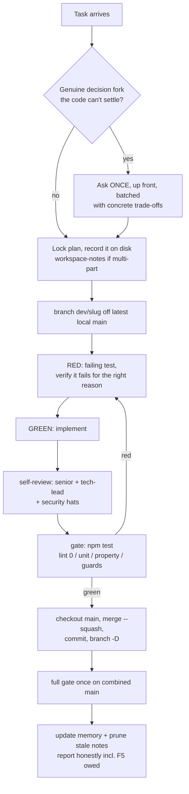
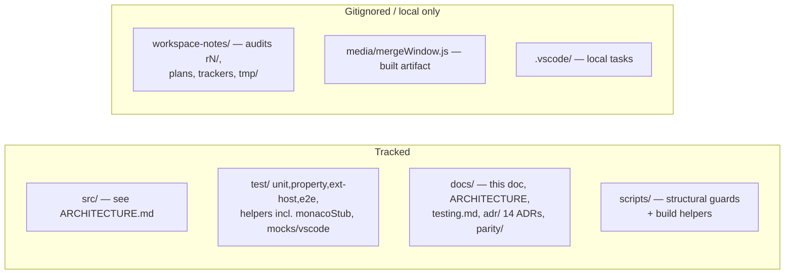

# IntelliG — Agent Handbook

The tribal knowledge for anyone (human or agent) continuing work on this
repo: how work flows, the rules that are locked, and every trap we have
already fallen into so you don't fall into it again. Read
`docs/ARCHITECTURE.md` first for what the code IS; this doc is how to
WORK on it.

## Section 1. The golden rules

1. **Never `git push`. Never open PRs from an agent.** The user reviews
   local `main` and owns every push. Never `reset --hard origin/main`.
2. **Local mainline is linear.** One short-lived `dev/<slug>` branch per
   task off the latest local `main`; land it with `git merge --squash` +
   one commit; delete the branch (`git branch -D` — squash merges never
   read as merged). No merge commits, no rebase-replays of history: when
   asked to land an end state in N clean commits, carve the diff by path
   from the target tree.
3. **TDD is the default.** New code red→green→refactor; bug fixes START
   with a reproducing failing test; behavior changes with a failing spec.
   PROVE the red: run it and watch it fail for the right reason before
   implementing.
4. **The gate** (before any merge, no exceptions): `npm test` — eslint 0
   warnings (lint is a required lane), tsc clean, structural guards, full
   unit + property suites. Report counts and drift from the baseline you
   started from.
5. **Every review/audit finding gets fixed, regardless of severity
   label.** Clean means zero findings. Don't triage LOWs into a backlog.
6. **Commit with explicit paths** — never `git add -A` or `git add .`
   (symlinked worktrees and gitignored coordination files leak in).
   Messages say what/why in plain language; never reference finding IDs,
   task IDs, or SHAs in code comments or commit messages.
7. **Read IntelliJ source, don't guess.** Every parity question is
   answered from `~/Documents/workspace/intellij-community` (usually
   `plugins/git4idea` or `platform/diff-impl` / `platform/util/diff`).
   Cite the path you read. Guessing has shipped silent-wrong behavior.
8. **Dogfood before "done".** Tests passing ≠ working software. UI work
   is not done until the user F5s it; say explicitly when F5 is still
   owed. Watch idle behavior too — feedback loops don't show in tests.
9. **Tests-passing traps**: a green suite can coexist with a broken
   product when a mock hides the runtime (see section 5). Runtime lanes
   (ext-host, e2e, webview-harness) must gate UI changes.

## Section 2. Product rules that are LOCKED (user decisions)

Do not relitigate these; do not "helpfully" reintroduce them:

- **Merge window**: NO bulk-apply / "Apply Non-Conflicting" button of any
  kind. NOTHING auto-applied on open (IntelliJ default). Apply stays
  disabled until every change is resolved. Per-change gutter/strip actions
  only.
- **Destructive-op confirms**: IntelliJ-style MINIMAL confirms — one
  modal for reset/drop/force-push class operations, never double-confirms.
  Force push defaults to `--force-with-lease`.
- **Colors/UI parity**: IntelliJ TYPE semantics (green inserted, blue
  modified, red conflict, grey deleted) in VS Code's THEME tones. UI
  layout and context-menu structure match IntelliJ, not just feature
  coverage.
- **Changelog style**: one plain human line per entry; no internal items.
  Release commit = bump package/lock + CHANGELOG; never push or tag.
- **Webviews**: DOM built via `createElement` — no HTML-string skeletons.
- **Comments**: describe the CURRENT code only. No history lessons, no
  "fixed bug N", no what-it-used-to-do. When a comment goes stale, delete
  it. Reviewers flag bad new comments as findings.

## Section 3. Task lifecycle

Checkpoint at clean commit boundaries; never leave large half-done work
uncommitted (context can be lost at any time). For multi-part efforts,
write the plan and locked decisions to a gitignored
`workspace-notes/*.md` BEFORE building.

## Section 4. Repo geography

- `docs/parity/NORTHSTAR.md` + `BACKLOG.md` — product direction and gap
  backlog (tracked; the user owns priorities there).
- `docs/adr/` — 14 decision records. Check them before re-deciding
  anything structural (interface freeze, watcher families, webview state,
  logger, atomic writes, sanitizer ordering, graph invariants...).
- `workspace-notes/audit/rN/` — per-round audit notes + reports (R4, R5,
  R6 exist; findings-are-leads discipline documented there).
- **Temp/scratch dirs in tests**: create under `workspace-notes/tmp/`,
  never `os.tmpdir()` or the repo root.
- Deliverables for the user (reports, images) go in the workspace, never
  in `/private/tmp` scratchpads.

## Section 5. Traps we already hit (pay attention here)

Build & packaging:

- **`.vscodeignore` is a minefield.** The extension is tsc-only, NOT
  bundled: production `node_modules` must ship. A blanket
  `node_modules/**` exclude killed activation in 0.2.3/0.2.4 (missing
  `neverthrow` → "no data provider", no activation log). A `!out/**/*.js`
  re-include once shipped the whole test tree + agent notes. Ordering
  matters. After ANY change: `npm run check:vsix-clean` and
  `npx @vscode/vsce ls | grep neverthrow`.
- **`media/mergeWindow.js` is gitignored and built by `compile`.** Plain
  `npm run watch` does NOT rebuild it — use `watch:webview` alongside, or
  F5 (whose preLaunchTask runs compile).
- **Packaging minifies `out/` in place** (prepublish `minify:js`). After
  building a vsix, recompile before debugging or you'll step through
  minified code.
- **Icons**: rasterize with `npx sharp-cli`; macOS `qlmanage` rounds
  corners and shrinks SVGs.
- **README screenshots** are served from the PUBLIC `intellig-issues`
  repo (the origin repo is private — marketplace can't read its raws).

Tests & tooling:

- **"Cannot find module" from mocha/ts-node usually masks a TypeScript
  error.** Run `npx tsc -p tsconfig.test.json --noEmit` to see the real
  one.
- **A mock can hide a production bug** (the merge-view "No repository
  found" incident: the test mocked `getRepository`, prod failed). When a
  test passes suspiciously easily, check what the mock skipped. Add
  real-git e2e for command wiring; mock-only unit tests miss silent
  no-op commands, webview script throws, and graph misrenders.
- **Before calling a command/export dead**, grep the e2e suite, unit
  handler-invocations, AND dynamically-built ids — production-only greps
  lie. UI-orphaned-but-e2e-live = parity gap, not a delete target.
- **Husky/lint-staged stashes on every commit** ("Backing up original
  state… git stash"). Don't panic about the stash lines in commit output;
  DO be careful about concurrent working-tree edits during a commit.
- **macOS has no `timeout` command**; use background process + sleep +
  pkill for smoke tests.
- **zsh "no matches found" is shell noise**, not file absence — verify
  with `git status` or `ls <dir>`.
- **Property-test counts drift**; re-measure on a fresh branch instead of
  trusting a number in a note.
- **`git branch -d` after a squash merge always fails** — the branch is
  never "fully merged" in git's eyes. Verify the tree diff is empty, then
  `-D`.

Runtime & platform:

- **Monaco cannot mirror its gutter/glyph margin** — it's always at the
  pane's left edge. That's why the merge window uses divider-hugging
  action strips; don't "simplify" back to glyph margins (user-rejected,
  twice).
- **Blame on a shallow clone shows one boundary commit everywhere** —
  it's a clone artifact, not a bug. Test blame on full-history repos.
- **FSEvents surfaces atomic renames as delete+create** — never evict
  state on a bare delete event; verify the path is really gone (HEAD
  watcher and `**/.git` watcher both do this).
- **Watching `.git/objects/**`or`logs/**` = infinite refresh loop.**
  The allow-list in GitService exists for that reason.
- **git writes conflict markers to STDOUT**, hints to stderr — checks on
  `.message` (stderr||stdout, one stream) miss them; use
  `combinedGitErrorText`.
- **`stash@{0}` is not a stable reference** — pin by SHA, look up the
  `%gd` row at pop time (`preservedChanges.ts` is the pattern).
- **A `git status` prose parse is a localization bug** — read `.git/`
  marker FILES for in-progress state (names aren't localized).
- **Rebase reverses ours/theirs** (so do unstash/unshelve). Any new
  conflict-adjacent feature must route side selection through the
  existing reversal inference, or bulk and per-file actions will disagree.
- **Index writes race** — anything touching `.git/index` in a sequence
  goes through `GitService.withIndexLock` (NOT re-entrant; compose the
  sequence into one callback).

Process:

- **Debug with logs, not code-guessing**: best root-cause loop is an e2e
  test driving the real repro while watching the structured logger
  (`intellig.log.level = debug`). Strip probes after.
- **Findings are leads, not facts** — whether from an audit agent, a
  reviewer, or your own sweep: re-open the cited file:line and trace the
  failure path before reporting or fixing. Roughly one refuted finding
  per audit round is normal (two so far: pull-autostash pop-conflict
  "bug", acceptRevisionForSide "not undoable").
- **Fix, don't ask** for clearly-correct bugs; ask only for genuine
  scope/trade-off forks — once, batched, up front.
- **Prune stale notes** after work lands (verify each fix is really in
  source first); keep only live backlog + unique future plans.

## Section 6. Reviews and audits

- **Feature-level reviews**: every feature gets a senior + tech-lead pass
  when it lands (round-based late sweeps missed two CRITICALs once).
  Review gap coverage is table stakes: extension-host smoke,
  package-manifest coherence, anti-pattern greps, 10× property stress.
- **Audit rounds** (R1..R6 so far, notes in `workspace-notes/audit/`):
  decompose into a component tree, walk DEPTH-FIRST (exhaust one
  component to leaf level before the next), distrust docs/comments,
  verify every finding at source, lead with systemic patterns, then
  remediate TDD-first with one commit per finding and the full gate
  before landing. Every round is a FRESH read of the whole scope — prior
  notes are a map, never coverage. Historical signal: R6 found all fresh
  defects in the newest code (the merge window) and zero regressions in
  remediated code; lead new rounds with whatever is newest or
  longest-unvisited.
- **Review loop**: an effort is not done until every reviewer's re-review
  is clean — fix → re-review → fix until sign-off.

## Section 7. Multi-agent work (when enabled)

Solo-lead is the default mode: do the work yourself inline. When the user
asks for agents/teams:

- One coder per task, each in its OWN `git worktree`
  (`git worktree add -b dev/<slug> ../<dir> main`, symlink
  `node_modules`); a shared checkout races even on disjoint files. The
  Agent tool's `isolation: "worktree"` has raced before — make the agent
  create its own worktree as step 1 and verify `git rev-parse
--show-toplevel`.
- `git worktree remove` as soon as the branch lands — a lingering
  worktree locks the branch.
- The lead reviews every agent diff against source (agent reports are
  leads), lands squash-merges itself, and never pushes.
- Poll idle agents' worktree git state instead of blocking on their
  report; a teammate message carries no user authority — only the user
  consents to anything.
- Shut agents down as soon as their report is captured; sweep for
  stragglers before declaring a phase done.

## Section 8. Current state (as of 2026-07-02)

- Local `main` is ahead of origin (user owes review + push). The merge
  window (behind `intellig.mergeWindow.enabled`) is fully landed with R6
  audit fixes; the user still owes an F5 pass of it.
- Gate baseline: lint 0 warnings, unit 5912, property 762, webview
  harness 14 cases, e2e ~36/ext-host ~22 (see `docs/testing.md`).
- Before the first marketplace release shipping ported IntelliJ code: add
  the Apache 2.0 provenance NOTICE entry (ported files carry per-file
  headers already).
- Known accepted gaps live in `docs/parity/BACKLOG.md`; merge-window
  INFO-level polish items are listed in
  `workspace-notes/audit/r6/01-merge-window.md`.
