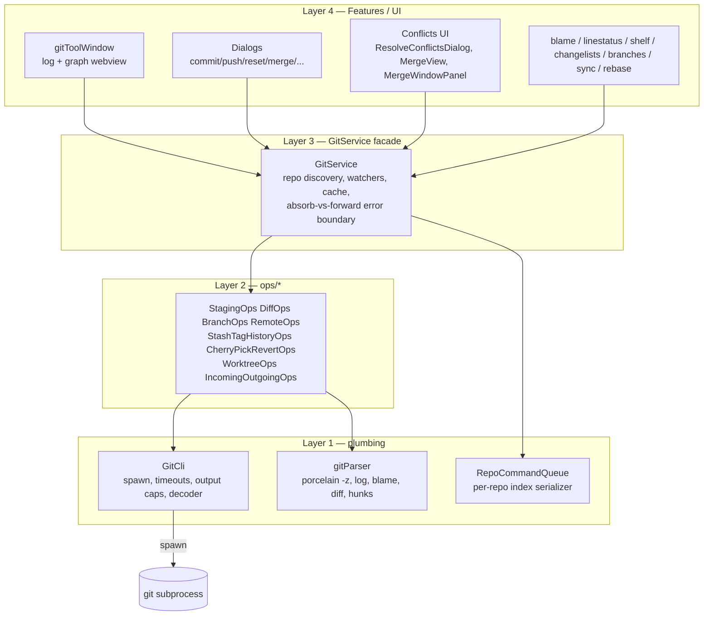
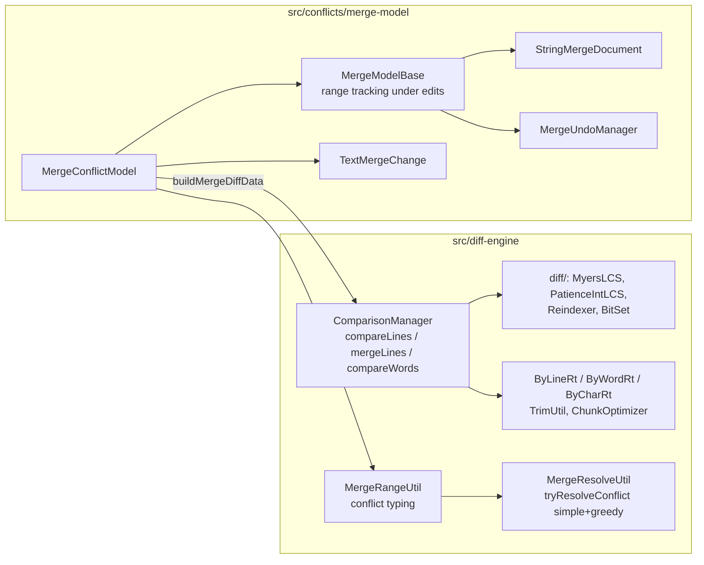
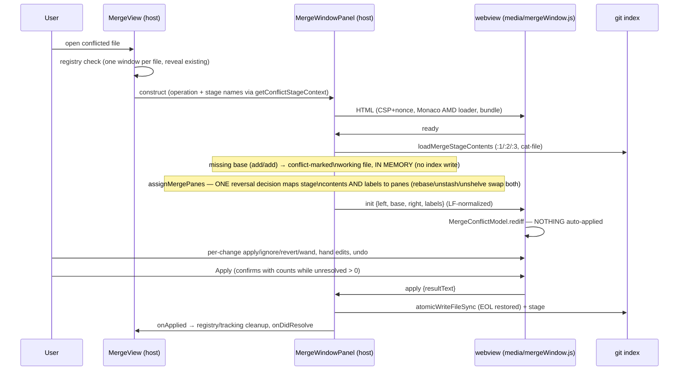
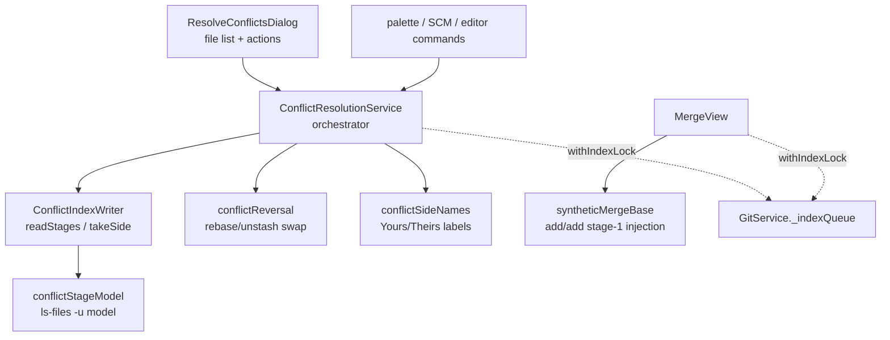
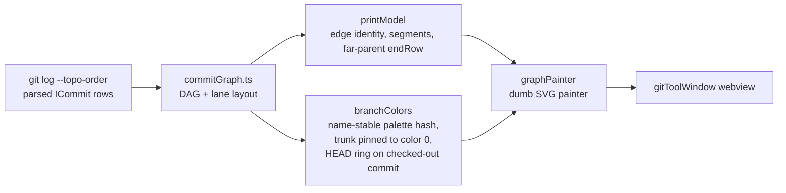
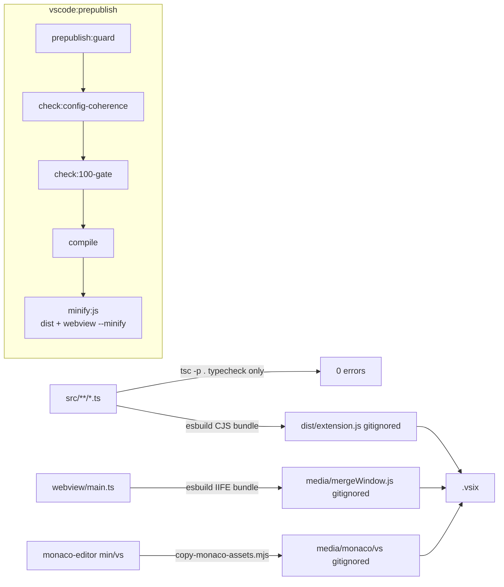

# IntelliG — Technical Architecture

The complete technical reference for the IntelliG VS Code extension: what
every subsystem does, how the layers fit, and how data flows through the
hot paths. Companion docs: `docs/AGENT-HANDBOOK.md` (working conventions and
tribal knowledge), `docs/testing.md` (test layers), `docs/adr/` (decision
records).

## Section 1. What this extension is

IntelliG brings IntelliJ's git tooling (the `git4idea` plugin) to VS Code:
log graph tool window, changelists, shelf, blame, line status, branch
popup, IntelliJ-style dialogs (commit, push, reset, merge, rebase editor),
a conflict-resolution workflow, and an opt-in three-pane merge window
powered by a TypeScript port of IntelliJ's actual diff/merge engine.

The product vision: **the best native-feeling Git UI for VS Code users who
miss IntelliJ's.** IntelliJ `git4idea` is the inspiration and the behavioral
REFERENCE, not a spec — a local checkout of `intellij-community` is kept next
to this repo, and when a behavior question comes up the answer is read from
that source, not guessed. But native VS Code idioms are a feature (the 3-way
merge defaults to VS Code's own editor, commit routes through the native SCM
API, dialogs lean on QuickPick), reliability beats coverage, and visual
fidelity is deliberately capped: accepted non-matches include the blame
gutter (single inline decoration with a recency tint, not a Swing
multi-column gutter), the log panel (webview flex rows, details on the
right), and the QuickPick dialog paradigm.

## Section 2. Layer model

Everything sits on a strict four-layer stack. Higher layers never spawn git
themselves; lower layers never import vscode UI.

Separate from this stack are two self-contained ported libraries:

- `src/diff-engine/` — IntelliJ `platform/util/diff` transliterated to TS
  (Myers/Patience LCS, by-line/by-word/by-char comparison, merge fragment
  computation, conflict typing, magic-resolve). Pure, no vscode imports.
- `src/conflicts/merge-model/` — IntelliJ's `MergeConflictModel` /
  `MergeModelBase` / `TextMergeChange` with a headless document
  (`StringMergeDocument`) and undo manager replacing the IntelliJ platform
  pieces. Also pure.

Both carry their upstream test suites (ported data-driven cases + fuzz
suites re-expressed as fast-check properties).

## Section 3. Layer 1 — GitCli and parsing

`src/git-core/gitCli.ts` is the only place a git process is spawned.

- **Timeouts**: per-verb defaults (network verbs 300s, local 600s,
  clone/ls-remote unbounded); explicit `timeout: 0` opts out. On expiry:
  SIGTERM, then SIGKILL after a 2s grace (credential helpers trap SIGTERM).
- **Output capture**: one `StringDecoder` per stream (multi-byte UTF-8
  sequences split across pipe chunks otherwise decode as U+FFFD), and
  `appendCapped` bounds each stream at 64 MiB so a runaway command can't
  overflow V8's max string length and crash the host.
- **Spawn resilience**: the bare `git` name is resolved to an absolute path
  once at construction (works around libuv `posix_spawnp` ENOENT flakes
  under fork pressure); a true spawn failure (`Failed to execute git:` +
  ENOENT) is retried exactly once. Failing _hooks_ that print ENOENT do NOT
  retry — the match is on the spawn-failure shape only.
- **argv injection**: `buildGitArgs(subcommand, flags, refs, paths)`
  splices `--end-of-options` between flags and refs and `--` before paths.
  Commands that don't support `--end-of-options` (e.g. `git remote`) use
  leading-dash/dot validation instead. Property-tested in
  `gitArgInjection.property.test.ts`.

`src/git-core/gitParser.ts` parses everything: porcelain `-z` status
(NUL-safe paths), log/branch/tag/stash with `\x1f` separators, remotes,
HEAD, C-style-quoted diff paths, hunks (budget-bounded body so split
artifacts can't become phantom context lines; per-side line numbers;
`\ No newline` markers ride on the preceding line), and `--porcelain`
blame.

`src/git-core/gitError.ts` owns sanitization: credential redaction for
both userinfo URL shapes (with a secret heuristic for the no-colon PAT
form), home-dir redaction for POSIX + two Windows shapes (ordering
matters — see ADR-005), `formatActionFailureToast` as the single toast
seam, and `combinedGitErrorText` (conflict markers land on stdout, so
`.message` alone misses them).

## Section 4. Layer 2 — ops/\*

Stateless collaborator classes, one per domain, reached through
`IGitOpsContext` (a lazy getter for the live GitCli — never captured at
construction, so tests can swap the CLI). All return
`ResultAsync<T, GitError>` (neverthrow); classification happens at the
spawn boundary via `classifyGitCommandError`.

Shared destructive-path infrastructure lives beside them:

- `worktree/restoreToHead.ts` — THE "make these paths match HEAD" writer.
  Partitions paths by HEAD membership (probe or caller hint): tracked →
  one batched `checkout HEAD --`, added/renamed-to → `rm --cached
--ignore-unmatch` batch, opted-in disk deletes → `removeInsideRepo`
  (realpath-parent containment guard; the ONLY sanctioned recursive
  delete).
- `ops/preservedChanges.ts` — the save/run/restore stash bracket
  (git4idea `GitPreservingProcess`). The created stash is pinned by SHA
  and popped via its `%gd` row at pop time, because `stash@{0}` is not
  stable.

## Section 5. Layer 3 — GitService

`src/git-core/GitService.ts` (~2.5k lines) is the facade every feature
depends on. Its own responsibilities:

- **Discovery**: workspace scan (`scanFolderForGitRepos`, depth + ignore
  settings), lazy per-file discovery (`getRepository(fileUri)` resolves by
  deepest-ancestor match against known repos, then `rev-parse` with a
  directory cwd), mid-session `**/.git` create/delete watchers with depth
  parity to the scan.
- **Watching — two lanes** (a port of VS Code's git-extension response
  policy). REF lane: a narrow allow-list of `.git/` entries per repo (HEAD,
  index, refs/**, packed-refs, config, in-progress markers) — never
  `objects/**`or`logs/**`(self-triggered refresh loops) — funnels into a
250ms debounced full reload with an in-flight guard and fires`onDidChangeRepository`. STATUS lane: the broad `**`working-tree watcher
(a save can only change file statuses, never refs or the log) runs through`statusLane.ts`— 1s trailing debounce, refresh deferred while the window
is unfocused, a 5s floor between runs — defers to any ref-lane reload that
covers it, and fires`onDidChangeWorkingTree`(role interface`IGitWorkingTreeEvents`, ADR-001). Views that render file statuses (SCM
provider, changelists) MUST subscribe to BOTH events; everything else
(graph, branches, blame, caches) subscribes to the repository event only.
HEAD deletion is verified against a readdir before evicting (FSEvents
surfaces renames as delete+create). Watcher families register in
`\_watcherMaps` (ADR-008) so teardown walks them uniformly.
- **Lifecycle safety**: a `_disposed` latch checked at every async
  re-entry; per-root removal-generation counters so an in-flight load
  can't resurrect a removed repo; `_enrollReload` tracks in-flight loads
  for coalescing and test drains.
- **Contention control**: `_statusInFlight` coalesces concurrent status
  walks; status yields to an in-flight `getLog` (bounded 4s, with a
  startup grace window) so the graph paints before the untracked-file walk
  saturates the disk.
- **Index serialization**: `withIndexLock(root, fn)` — one
  `RepoCommandQueue` for all index-mutating sequences (conflict accepts,
  native-editor synthetic-base injection). NOT re-entrant.
- **Error boundary**: the absorb-vs-forward pattern. Methods feeding
  passive views absorb the ops `Result` (log the fault, degrade to
  empty/default); methods behind user actions forward the `ResultAsync`
  for the caller to `.match` and toast. Which one a method does is
  documented on the method.

The `IGitService` composite interface is frozen (ADR-001); new
capabilities land on the concrete class and consumers narrow to it.

## Section 6. Diff engine and merge model (the ported core)

Key invariants (violating any of these is a bug):

- All engine/model text is LF-only. EOL detection/restoration happens at
  the host boundary (`mergeWindowText.ts`).
- `TextMergeChange` indices are stable identities — the change array is
  never reordered after `rediff()`; base-side line ranges live in
  `MergeModelBase` and track document edits via
  `beforeDocumentChange`/`updateRangeOnModification`.
- Undo ordering: inside a command, range-state restore actions are
  registered BEFORE the document's own change action, and undo runs the
  group in reverse — text restores first, then ranges. Nested
  `executeCommand`s merge into the outer group.
- Conflict typing (`getMergeType`) requires an explicit resolution
  strategy; the constructor signature makes the Kotlin-default footgun
  (everything claiming resolvable) impossible.

## Section 7. The merge window (opt-in three-pane resolver)

The default conflict-resolution surface (`intellig.mergeWindow.enabled`,
default on); the native VS Code merge editor is the fallback — used when
the setting is turned off or the window's dependencies are unavailable. The entire merge model runs INSIDE
the webview; the host only loads stages and finalizes.

Host side (`src/conflicts/merge-window/`):

- `MergeWindowPanel` extends `BaseWebviewPanel`; overrides `_wrapHtml` to
  add the Monaco AMD loader (CSP `script-src` therefore includes the
  webview resource origin, not just the nonce). Title is HTML-escaped. A
  malformed `apply` without `resultText` is rejected (fail closed).
- `mergeStages.ts` — reads the three stages; missing SIDE stage → empty
  (delete/modify), missing BASE → conflict-marked working file in memory
  (parity: `GitMergeUtil.loadMergeData`).
- `MergeView` routes: flag on + deps + gitCli → window (no index writes);
  else native editor with `_injectSyntheticBase` (the native editor reads
  stages from the index, so add/add needs a synthetic stage-1 written
  there — under `withIndexLock`). One window per file via a
  canonical-path registry cleaned on `onDidDispose`.

Webview side (`webview/main.ts`, bundled by esbuild to
`media/mergeWindow.js`, gitignored, built by `compile`):

- **Controlled-mirror pattern**: the document of record is the model's
  `StringMergeDocument`. Monaco is a mirror — user edits replay onto the
  document (one undo command per batch, high-offset-first), programmatic
  changes flow back under an `applyingToMonaco` suppression flag, and
  `assertInSync` resyncs on divergence (logged to the host). Monaco's own
  undo is bypassed; Ctrl+Z/Shift+Ctrl+Z/Ctrl+Y route to
  `MergeUndoManager` so text and change-state restore together.
- **Layout**: side panes are read-only Monaco editors; two divider gutters
  carry ONLY curved canvas connectors (bezier trapezoid + center hairline,
  `CTRL_PROXIMITY_X = 0.3`, per IntelliJ `DiffDrawUtil`); per-change
  apply/ignore/revert icons live in 34px divider-hugging ACTION STRIPS
  (IntelliJ mirrors the left editor's gutter to its right edge — Monaco
  cannot, so the strips stand in); the result editor's glyph margin
  carries only the magic-resolve wand.
- **Colors**: IntelliJ type semantics (green inserted / blue modified /
  red conflict / grey deleted) in VS Code's own merge-decoration tones;
  resolved changes render as dotted boundary lines, no fill. Theme
  switches are followed live (MutationObserver on the body class).
- **Scroll sync**: piecewise-linear anchors from change ranges;
  `mapLine` is fractional/continuous so driven panes glide; each scrolled
  pane drives BOTH others directly (relaying through the result pane would
  be eaten by the reentrancy guard).
- **Navigation**: prev/next from the CARET (IntelliJ behavior), not a
  stored cursor. Reset = IntelliJ's `RevertConflictResolutionAction`: one
  undoable command over FULLY resolved changes only.

Toolbar semantics follow IntelliJ's `MergeThreesideViewer`: Accept
Yours/Theirs confirm before discarding a modified result
(`MergeUtil.showConfirmDiscardChangesDialog`); Apply is always enabled and
confirms with unresolved counts before marking everything resolved
(`handleResolvedCase`); Apply Non-Conflicting and Resolve Simple Conflicts
are the bulk actions; nothing is auto-applied on open unless the opt-in
`intellig.mergeWindow.autoApplyNonConflicting` setting is on. Destructive
confirms run as HOST modals via the `confirm`/`confirmResult` protocol
round trip — the webview never destroys work before the answer.

Known divergence (VS Code platform limit): IntelliJ vetoes closing the
merge dialog behind an exit confirm; VS Code has no hook to veto a webview
tab close, so closing the merge-window TAB cannot prompt. Instead the
webview streams the modified result text with its `state` posts, the host
persists it in `workspaceState` keyed by repo root + path, and reopening
the file offers Restore / Discard Saved Result. Apply, a confirmed Abort,
and undoing back to pristine all drop the saved copy.

## Section 8. Conflicts subsystem (native path)

- The delete-vs-checkout decision keys off git STAGE presence (`ls-files
-u` model), never the porcelain `D` column.
- Rebase (and unstash/unshelve) REVERSE ours/theirs: stage 2 is the branch
  being replayed onto. `_isReversed` infers from repo state + recorded
  operation so bulk and per-file accepts always agree.
- Bulk accepts run under `withIndexLock` AND a per-repo `_bulkInFlight`
  guard; a dropped duplicate returns `skipped` (not success, not error).
- `markResolved` prunes entries no longer conflicted before resolving its
  target (active editor match, else sole entry); ambiguity → an
  information toast, never a guess.

## Section 9. Graph and log tool window

The graph pipeline is deliberately layered (mirrors IntelliJ
`vcs-log/graph`; see ADR-013 for the data-model invariants):

- Branch colors are NAME-stable (`palette[hash(name)]`, 10 hues), not
  row-rank — collisions are accepted. The white node ring marks the
  CHECKED-OUT commit (incl. detached HEAD), nothing else. Locally-named
  `main`/`master` pins to the trunk color; a local `dev/main` does not
  (the remote-tail heuristic applies only to remote refs).
- Startup performance is protected by: deferred rev-list count off the
  first paint, initial page 100, discovery `--untracked-files=no`, status
  coalescing + the status-yields-to-log gate, and graph-load coalescing.
  The count folds in via a lightweight attr update, not a re-render
  (reset-on-select regression class).
- The tool window (`gitToolWindow/`, ~20k lines) carries the log tab,
  branch/repo selector trees with tri-state branch filters, filters bar
  (author datalist, "Message or hash" with `--no-walk` hash lookup per
  IntelliJ's HASH_REGEX), jumpToHash, branch focus (merge-base), and
  context menus. All HTML is built via `createElement` (string-HTML is
  banned in webviews); everything user- or repo-controlled that reaches
  git goes through validation + `buildGitArgs`.

## Section 10. Webview infrastructure

- `BaseWebviewPanel` (dialogs) and `BaseWebviewView` (sidebar views) own
  the document envelope: CSP (`default-src 'none'`, nonce'd scripts,
  style/img/font from the webview origin), escaped `<title>`, message
  routing through `safeFireAndForget` with a sync-throw guard, idempotent
  dispose, and (panels) a once-only public `onDidDispose` event. Subclasses
  produce body parts; they must NOT re-template the document (the one
  sanctioned `_wrapHtml` override — the merge window's Monaco loader —
  re-implements escaping; treat any new override as a review flag).
- Webview state ownership: ADR-009. Message handlers surface user-facing
  errors via toasts INSIDE the handler; rejections reaching the base are
  logged only.
- Convention: all webview DOM is `createElement`-built (jsdom-testable —
  the shipped skeleton and the tested skeleton are the same function).

## Section 11. Other feature subsystems, briefly

- **blame/** — live-buffer blame (`--contents -`), whole-file gutter with
  grow-only width, per-line tint from a per-commit palette, hover commit
  link that reveals the commit in the graph. Per-sha porcelain parser,
  per-repo log cache.
- **linestatus/** — dirty-line gutter vs HEAD, IntelliJ line-status
  semantics.
- **changelists/** + **scm/** — IntelliJ changelists mapped onto VS Code
  SCM resource groups; storage round-trip is forward-compatible (ADR-003).
- **shelf/** — IntelliJ shelve/unshelve on patch files under
  `.git/intellig-shelf/`; `ShelveDialog` webview; symlink-contained
  deletes.
- **commits/** — CommitDialog + tool window, amend/fixup/squash flows,
  drop/reword/squash via `buildSquashRebasePlan` with the
  save/restore-stash bracket, "Drop Selected Changes" via the shared
  restore-to-HEAD writer.
- **branches/** — BranchPopup (status-bar), BranchTreeProvider, New
  Branch dialog, compare/rename/upstream, worktree-aware checkout errors.
- **sync/** — fetch/pull/push dialogs, updateProject (pull with
  `--autostash`; this flag sets the supported-git floor at 2.27 —
  `MIN_SUPPORTED_GIT`), incoming/outgoing badges.
- **rebase/** — interactive rebase editor over `rebaseTodo` parsing, plus
  `RebaseService` (paused-rebase detection/recovery, activation warning).
- **utils/** — structured logger (ADR-011; level-gated OutputChannel
  sinks), `atomicWrite` (ADR-004), `escapeHtml`, `repoRelativePath` /
  `canonicalizeFsPath` (symlink-safe pathspecs — macOS `/var` →
  `/private/var`), `safeFireAndForget` (every fire-and-forget promise
  routes here with a context string).

## Section 12. Activation and wiring

`extension.ts` builds the object graph: GitService → feature services →
providers/views → command registration (`commands/` +
`registration/`). Commands resolve their repo via `resolveRepo`
(explicit arg → active editor → sole repo → picker). Startup ordering is
performance-sensitive (see the graph notes in section 9); discovery and
initial loads are fire-and-forget with logged failures, and late workspace
folders arrive via the folder-change listener.

## Section 13. Build, packaging, gates

- `compile` = `tsc -p ./` (typecheck, `noEmit`) + `build:extension`
  (esbuild bundles src/extension.ts and every runtime dep into
  `dist/extension.js`, `vscode` external) + `build:sequence-editor`
  (`dist/rebaseTodoEditor.js`) + `build:webview` (`media/mergeWindow.js`)
  - `copy-monaco-assets.mjs` (Monaco AMD build → `media/monaco/vs`,
    cached by version marker). `watch` is tsc-only; F5's preLaunchTask
    rebuilds the bundles.
- Minification happens ONLY at packaging (`minify:js`, last prepublish
  step): the same three esbuild bundles with `--minify`. It is a no-op
  under `INTELLIG_INTERNAL_PREPUBLISH_DRYRUN=1` (the structural-guard
  bypass), so `vsce ls` runs during `check:all` don't minify. A real
  packaging run leaves `dist/` + `media/mergeWindow.js` minified until
  the next compile.
- The extension is BUNDLED — nothing ships from `node_modules/` or
  `out/`, and there are no production dependencies in package.json
  (neverthrow is compiled into the bundle; monaco-editor and
  @vscode/codicons are build-time asset sources). `check:vsix-clean`
  asserts both directions: no forbidden files AND the runtime manifest
  (dist bundle + media assets) present. `.vscodeignore` ordering still
  matters — read its header before touching it.
- The full gate = `npm test`: eslint `--max-warnings 0` (lint is a
  required lane), compile, `check:all` (the structural guard scripts in
  `scripts/check-*.sh|.mjs` — toast sanitization, pathspec
  canonicalization, `--end-of-options` splices, watcher-family
  registration, vsix cleanliness, command coverage/reachability, webview
  coverage, no bare console, no inline handlers, no section symbol),
  full unit + property suites. Test-layer reference: `docs/testing.md`.

## Section 14. Error-handling model (repo-wide)

- Ops return `ResultAsync<T, GitError>` (neverthrow); the error taxonomy
  lives in `git-core/errors.ts` with a `kind` discriminant.
- GitService facades either ABSORB (log + degrade — passive views) or
  FORWARD (caller toasts — user actions); each method documents which.
- Empty `catch {}` is banned by lint (`no-restricted-syntax`); every
  justified swallow carries an eslint-disable line explaining why the
  error is genuinely unactionable.
- Anything user-visible goes through `sanitizeGitError` /
  `formatActionFailureToast`; structural guards enforce the toast sites.
